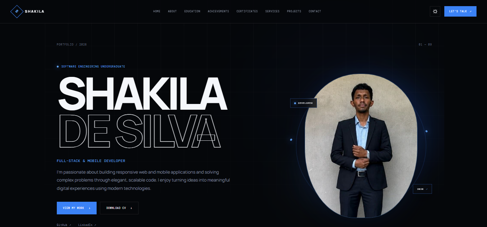

# 👨‍💻 Shakila De Silva

### Software Engineering Undergraduate | Full-Stack & Mobile Developer

Building modern web and mobile applications with thoughtful design and practical technology.

---

## 🌐 Live Portfolio Preview

**[🚀 Explore the Live Portfolio](https://shakila-portfolio-nine.vercel.app/)**

---

## 👋 About Me

Hi! I'm **Shakila De Silva**, an Information Technology undergraduate specializing in Software Engineering.

I'm passionate about designing and developing practical software solutions across web and mobile platforms. I enjoy exploring different technologies, solving development challenges, and turning ideas into functional applications.

My interests include:

- 🌐 Full-Stack Web Development
- 📱 Mobile Application Development
- ⚙️ Backend Development and API Integration
- 🎨 Modern UI/UX and Interactive Experiences
- 🤖 Artificial Intelligence and Automation
- 🔐 Cybersecurity and Secure Software Systems
- ☁️ Cloud Technologies and Deployment

---

## 🛠️ Technology Stack

### Frontend Development

### Backend and APIs

### Mobile Development

### Databases and Cloud

### Tools and Platforms

---

## 💼 Featured Projects

A selection of web and mobile applications built while exploring different areas of software development.

| # | Project | Description | Technologies |
|---|---|---|---|
| 01 | [AgroPulse](https://github.com/SilvaDeShakila/AgroPulse) | Smart agriculture and farm operations platform. | TypeScript, Web |
| 02 | [FOODORA](https://github.com/SilvaDeShakila/FOODORA) | Full-stack food delivery platform with restaurant discovery, cart, checkout, and order tracking. | React, TypeScript, Node.js, Express |
| 03 | [NEXORA Studio](https://github.com/SilvaDeShakila/NEXORA-STUDIO) | Creative video and photo editing platform with timeline editing and visual effects. | React, FastAPI, FFmpeg |
| 04 | [AutoForge](https://github.com/SilvaDeShakila/autoforge) | Automotive web platform with vehicle-related features and a responsive interface. | Next.js, React, TypeScript |
| 05 | [Smart Workspace](https://github.com/SilvaDeShakila/smart-workspace) | Full-stack workspace application with a React frontend and Express backend. | React, Vite, Node.js, Express |
| 06 | [VoteX](https://github.com/SilvaDeShakila/voteapp) | Digital voting application with voter verification and election management. | Flutter, Dart, Firebase |
| 07 | [Hotel Management System](https://github.com/SilvaDeShakila/HotelManagementSystem) | Hotel management system covering reservations and operational workflows. | Python, Flask, HTML |
| 08 | [Shopora](https://github.com/SilvaDeShakila/shopora-premium-ecommerce) | E-commerce mobile application with product browsing, cart, wishlist, and themes. | Flutter, Dart, Provider, REST API |
| 09 | [Mealora](https://github.com/SilvaDeShakila/mealora-food-delivery-app) | Food delivery mobile application with restaurant discovery, checkout, and order history. | Flutter, Dart, Provider |
| 10 | [Skyora](https://github.com/SilvaDeShakila/skyora-weather-forecast-app) | Weather application with city search and forecast information. | Flutter, Dart, Weather API |
| 11 | [Expense Tracker](https://github.com/SilvaDeShakila/expense-tracker-flutter) | Expense management application with cloud data and spending insights. | Flutter, Dart, Firebase, Firestore |
| 12 | [Quizora](https://github.com/SilvaDeShakila/quizora-learning-app) | Interactive quiz application with multiple subjects, topics, and progress tracking. | Flutter, Dart, SQLite |
| 13 | [TaskFlow](https://github.com/SilvaDeShakila/TaskFlow) | Task management application with priorities, filters, and productivity statistics. | Flutter, Dart |
| 14 | [QuickQR](https://github.com/SilvaDeShakila/QuickQR) | QR utility application for generating, previewing, saving, and sharing QR codes. | Flutter, Dart |
| 15 | Accessible Cooking Assistant | Accessibility-focused cooking platform with voice-guided recipe assistance. | Next.js, TypeScript, Web Audio API |

### 🌍 Available Live Demos

- [AutoForge](https://autoforge-tawny.vercel.app/)
- [Smart Workspace](https://smart-workspace-mocha.vercel.app/)

---

## 🎓 Education

**Bachelor of Information Technology (Hons.) in Software Engineering**

ESU ESOFT Uni, Colombo 04, Sri Lanka

*October 2022 – Present*

**Diploma in Information Technology**

ESOFT Metro Campus, Kurunegala

*January 2021 – June 2022*

Merit — 1,200-hour Pearson Assured Diploma.

**Ordinary and Advanced Level Education**

D.B. Welagedara Central College, Kurunegala

*January 2009 – August 2019*

---

## 🏅 Certifications

| Certification | Issuer | Verification |
|---|---|---|
| Basics of Artificial Intelligence | UniAthena | [View Certificate](https://uniathena.com/verify/certificate?certID=2044-1332-7068) |
| OOPs in Java | Great Learning | [View Certificate](https://www.mygreatlearning.com/certificate/UDHSAUQL) |
| Python Project Development | Great Learning | [View Certificate](https://www.mygreatlearning.com/certificate/TGDURRIC) |
| Foundational C# with Microsoft | Microsoft / freeCodeCamp | [View Certificate](https://www.freecodecamp.org/certification/fcc-2a0e5c2c-79a6-4fcf-a87f-386b2e9064c2/foundational-c-sharp-with-microsoft) |
| Advanced Linux Program | FOSS Community – University of Kelaniya | [View Badge](https://badges.parchment.com/public/assertions/Q19dpZmqQXGmhsE9gdt9Ig) |

---

## 🏆 Achievement

### 1st Runner-Up — THINKFEST 2025

**Level 3 Networking & Cybersecurity — Threat Detection & Incident Response**

---

## 📚 Currently Growing

I continuously work on improving my knowledge and practical skills in:

- Advanced frontend and backend development
- Software architecture and application design
- Database design and API development
- AI integration and automation
- Cybersecurity and Linux technologies
- Mobile application development
- Cloud deployment and developer tooling

---

## 📫 Connect With Me

I'm always interested in learning, building useful applications, and connecting with other developers.

- **Portfolio:** [shakila-portfolio-nine.vercel.app](https://shakila-portfolio-nine.vercel.app/)
- **GitHub:** [SilvaDeShakila](https://github.com/SilvaDeShakila)
- **LinkedIn:** [Shakila De Silva](https://linkedin.com/in/shakila-de-silva-6516b225)

---

### 💻 Code • Learn • Build • Improve

*Turning ideas into practical software solutions.*

© 2026 Shakila De Silva

